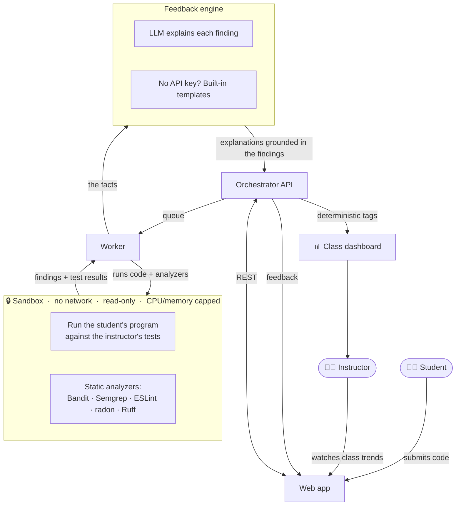
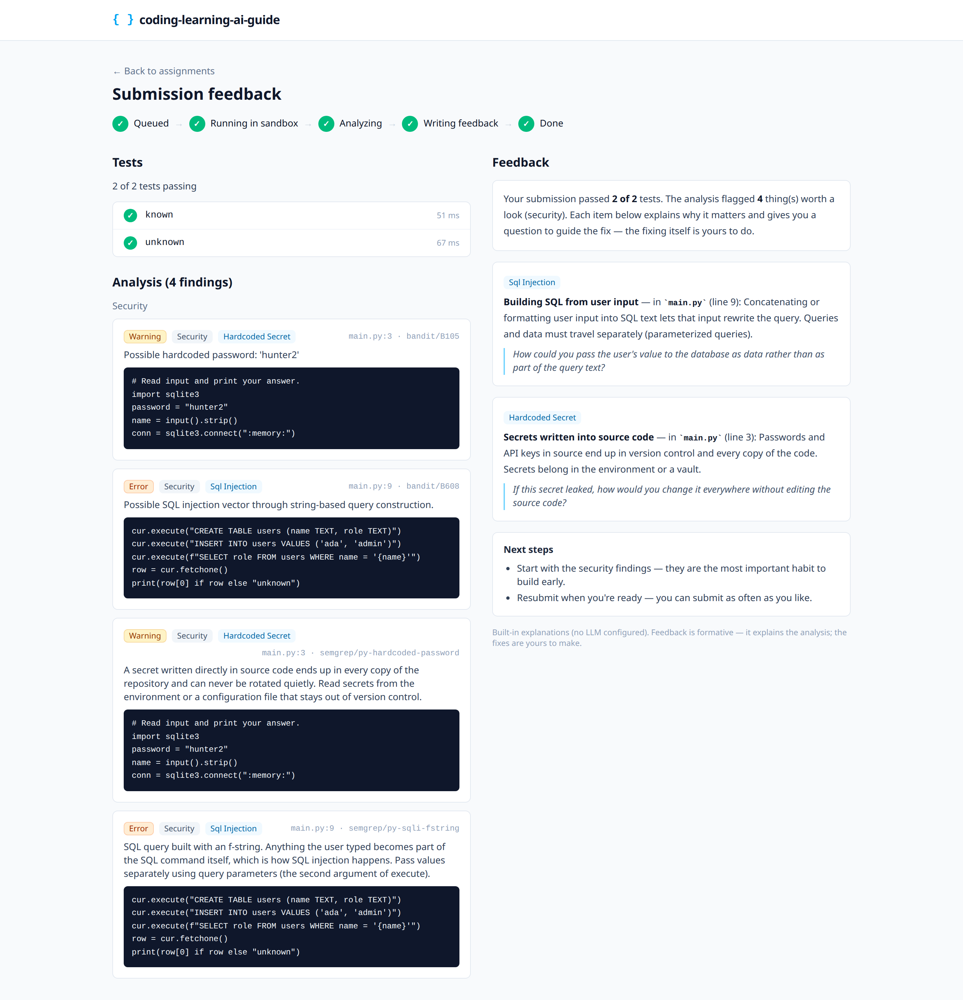
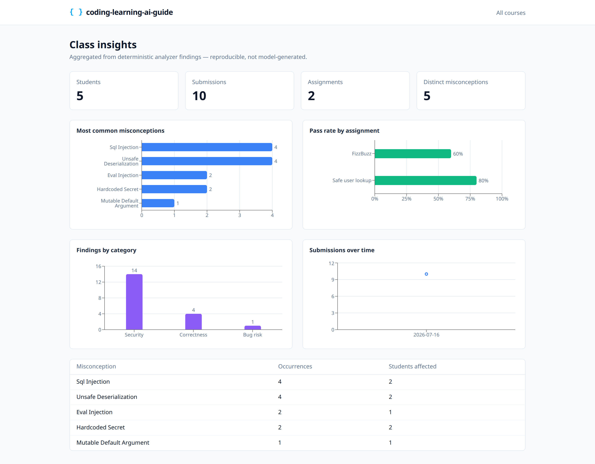
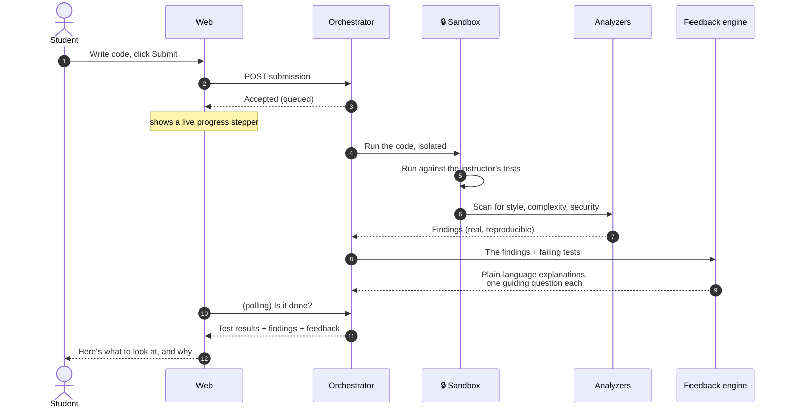
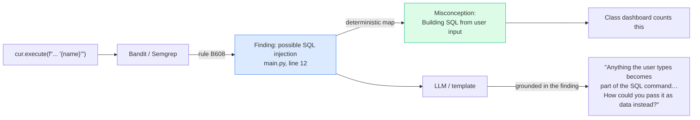

<div align="center">

# coding-learning-ai-guide

**AI code review and formative feedback for programming courses — deterministic analyzers, sandboxed execution, and LLM explanations you can trust.**

[](https://github.com/jjsanda/coding-learning-ai-guide/actions/workflows/ci.yml)
[](LICENSE)


</div>

Students submit code; the tool runs it in an isolated sandbox and returns
feedback on **correctness, style, complexity, and security** — then explains,
in plain language, *why* each issue matters and asks a guiding question instead
of handing over the fix. An instructor dashboard aggregates the whole class's
misconceptions so teaching can target what students actually get wrong.

## Why another feedback tool?

**Pure-LLM grading isn't trustworthy.** Ask a language model "is this code
correct and secure?" and it will confidently invent problems that aren't there
and miss ones that are. That's fine for a chat toy and dangerous for a grade.

**Deterministic analyzers are trustworthy but terse.** Tools like Bandit,
Semgrep, ESLint and radon find real, reproducible issues — but a beginner
staring at `B608: hardcoded_sql_expressions` learns nothing.

coding-learning-ai-guide **fuses the two**. The analyzers and the assignment's
test cases decide *what* is wrong — every finding is a real, reproducible fact.
The language model only *explains* those facts pedagogically. It is never
allowed to invent a problem: any explanation that doesn't point at a concrete
finding is discarded. And if no API key is configured, deterministic templates
produce the same structured feedback, so the tool works fully offline.

## How it fits together



## 60-second quickstart

**Requirements:** Docker and `make`. No API key needed — the demo runs entirely
on built-in feedback templates.

```bash
git clone https://github.com/jjsanda/coding-learning-ai-guide
cd coding-learning-ai-guide
make demo
```

`make demo` builds the images, starts the stack, and seeds two demo courses with
real analyzed submissions. When it finishes it prints course **join codes** and
an **instructor token**. Then open:

- **Web app** — <http://localhost:8080> — join a course with a printed code and submit code
- **Instructor dashboard** — sign in with the printed token to see class-wide insights
- **API docs** — <http://localhost:8000/api/docs>

Want richer explanations? Copy `.env.example` to `.env`, add an
`ANTHROPIC_API_KEY` (or OpenAI / Ollama), and restart — the feedback layer picks
it up automatically and the UI shows which provider produced each explanation.

## What it looks like

**Student — a submission's feedback**, with test results, categorized findings
(each with the exact rule and line), and pedagogical explanations that ask a
guiding question rather than giving the answer:



**Instructor — class-wide insights**, aggregated from deterministic analyzer
findings so the numbers are reproducible:



## The lifecycle of a submission



## Deterministic facts, AI explanation

The trust boundary is the whole point. Here's how one finding flows through:



The **misconception tags the dashboard aggregates come only from the
deterministic map** — never from the model. The model's job is the last box:
turning a true fact into a good explanation.

## Features

| | |
|---|---|
| 🔒 **Sandboxed execution** | Untrusted code runs with no network, a read-only filesystem, dropped capabilities, and CPU/memory/time limits. Analyzers run *before* the student's code executes. |
| 🧩 **Two languages, pluggable** | Python (Ruff, Bandit, radon, Semgrep) and JavaScript (ESLint + security plugin, Semgrep). Adding a language is one module — see [docs/adding-a-language.md](docs/adding-a-language.md). |
| 🛡️ **Security-aware** | Catches SQL injection, hardcoded secrets, unsafe deserialization, command injection, `eval`, XSS and more — mapped to teachable misconceptions. |
| 🤖 **Multi-provider AI** | Anthropic, OpenAI or Ollama behind one interface, with structured outputs. **Works with no API key** via deterministic templates. |
| 📊 **Instructor insights** | Class-wide misconception frequency, per-assignment pass rates, finding categories and submission volume. |
| ☸️ **Runs anywhere** | One-command Docker Compose demo, or a full Helm chart with Kubernetes Jobs, NetworkPolicies and an optional gVisor RuntimeClass. |

## Security model, briefly

The threat is a **malicious student submission**. Controls, in depth in
[docs/security-model.md](docs/security-model.md):

- **No network** — the sandbox has no network interface at all; results come
  back over stdout / pod logs, never a socket.
- **Least privilege** — non-root, read-only root filesystem, all Linux
  capabilities dropped, `no-new-privileges` / `seccomp: RuntimeDefault`.
- **Bounded resources** — memory, CPU, PID and wall-clock limits; a container
  that runs long is killed and reaped.
- **Analyzers run first** — static analysis happens on the pristine submission
  before any student code executes.
- **Defense in depth on Kubernetes** — per-submission Jobs in an isolated
  namespace, a default-deny NetworkPolicy, scoped RBAC, and an optional gVisor
  RuntimeClass for kernel-level isolation.

The threat model is honest about residual risk (e.g. the Docker socket trust in
Compose mode) rather than claiming perfection.

## Deployment

| Path | Command | Use for |
|---|---|---|
| **Docker Compose** | `make demo` | Local development and the one-command demo |
| **Kubernetes (kind)** | `make kind-demo` | A real cluster walkthrough with Jobs-based sandboxing |
| **Helm** | `helm install codeguide deploy/helm/coding-learning-ai-guide` | Production clusters |

Full deployment guide, Helm values reference and the gVisor note:
[docs/deployment.md](docs/deployment.md).

## Configuration

Everything is environment-driven; **all of it is optional**.

| Variable | Default | Purpose |
|---|---|---|
| `CODEGUIDE_FEEDBACK_PROVIDER` | `auto` | `auto` / `anthropic` / `openai` / `ollama` / `template` |
| `ANTHROPIC_API_KEY` | — | Enables Anthropic feedback (`CODEGUIDE_ANTHROPIC_MODEL`, default `claude-opus-4-8`) |
| `OPENAI_API_KEY` | — | Enables OpenAI feedback (`CODEGUIDE_OPENAI_MODEL`) |
| `CODEGUIDE_OLLAMA_BASE_URL` | — | Enables a local Ollama server |
| `CODEGUIDE_DATABASE_URL` | SQLite | Postgres in Compose / Helm |
| `CODEGUIDE_EXECUTION_BACKEND` | `docker` | `docker` / `kubernetes` / `local` |

See [.env.example](.env.example) for the full list.

## Developing

```bash
make install       # backend venv + frontend deps
make dev           # API with auto-reload  (frontend: cd frontend && npm run dev)
make test          # backend unit tests
make test-integration  # sandbox integration tests (needs Docker)
make lint          # ruff + eslint
make typecheck     # mypy + tsc
```

Architecture, data model and internals: [docs/architecture.md](docs/architecture.md).
Design decisions: [docs/adr/](docs/adr/). Contributing:
[CONTRIBUTING.md](CONTRIBUTING.md).

## Roadmap

Deliberately out of scope today, sketched for later: instructor-uploaded
`pytest`/`vitest` test files, similarity/plagiarism detection, LMS (LTI)
integration, live submission status over websockets, and horizontal worker
scale-out.

## License

Apache-2.0 © Josef Sanda. See [LICENSE](LICENSE) and [NOTICE](NOTICE).
