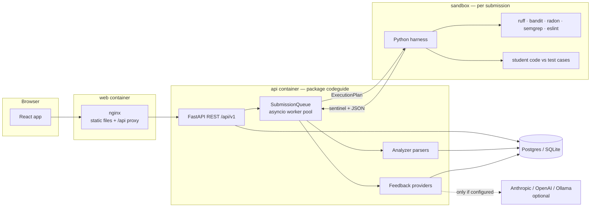
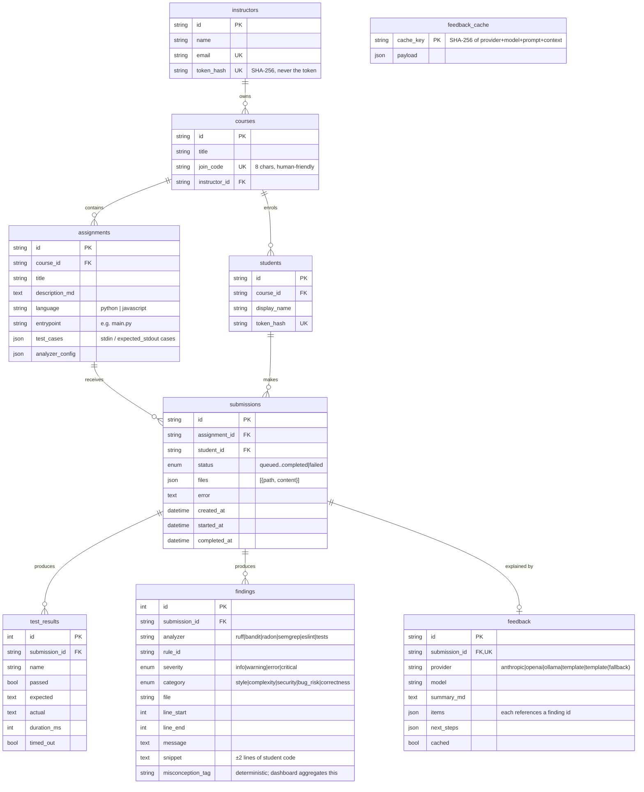
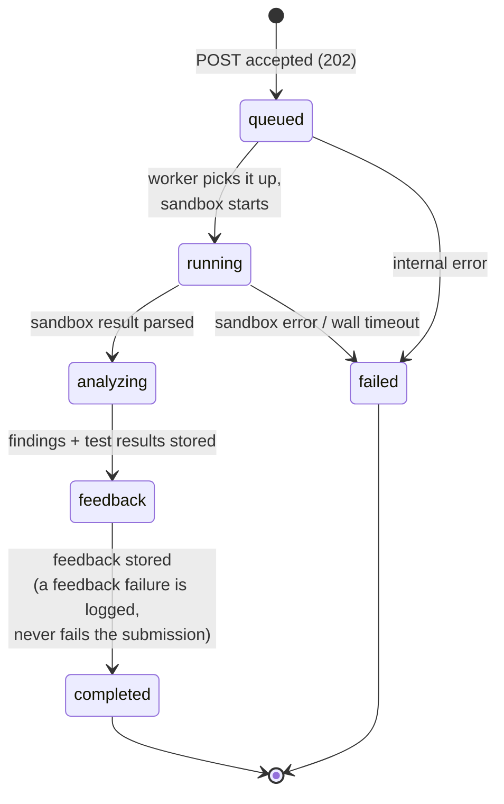

# Architecture

This document is the technical reference for how coding-learning-ai-guide is
put together: the components, the API surface, the data model, the submission
pipeline, and the three pluggable layers (execution backends, analyzers,
feedback providers). For the *why* behind the bigger decisions, see the
[design decisions](#design-decisions) section and [docs/adr/](adr/).

## Components

Four moving parts, deliberately few:

| Component | Technology | Role |
|---|---|---|
| **Web app** | React + Vite, served by nginx | Student submission UI and instructor dashboard. nginx also proxies `/api` to the orchestrator. |
| **Orchestrator API** | FastAPI (Python package `codeguide`) | REST API, auth, the submission queue and workers, analyzer parsing, feedback generation. |
| **Sandbox runners** | Two container images (`runners/python`, `runners/node`) | Where untrusted code runs. Both images share the same Python harness (`runners/harness/entrypoint.py`). |
| **Database** | SQLite by default, Postgres in Compose / Helm | All state: courses, submissions, findings, feedback. Migrations (Alembic) run automatically at startup. |



There is no message broker and no separate worker deployment: the queue and
workers live inside the API process (see [The submission pipeline](#the-submission-pipeline)).
The sandbox containers/pods are created on demand, one per submission, and
destroyed afterwards.

## API surface

Everything lives under `/api/v1` (OpenAPI docs at `/api/docs`). Two
unversioned probes sit outside it: `GET /healthz` (liveness) and `GET /readyz`
(readiness — verifies a database round-trip, returns 503 otherwise).

### Authentication model

Two principals, both authenticated with a `Bearer` token that is shown exactly
once and stored only as a SHA-256 hash (`backend/src/codeguide/auth.py`):

- **Instructors** — token minted by the CLI:
  `python -m codeguide.cli create-instructor --name "Ada Lovelace" --email ada@example.edu`.
  Prefixed `cgi_`.
- **Students** — token returned by `POST /auth/join` when joining a course
  with its 8-character join code (generated without ambiguous characters like
  `O`/`0`). Prefixed `cgs_`.

The prefixes exist so a leaked credential is immediately identifiable in logs
and reports. Authorization is ownership-scoped everywhere: instructors only
see their own courses (a foreign course ID returns 404, not 403, to avoid
leaking IDs), students only see their own course and their own submissions.

### Endpoints

**Meta**

| Method | Path | Auth | Purpose |
|---|---|---|---|
| GET | `/api/v1/meta` | none | Version, active execution backend and resolved feedback provider (the UI uses this for attribution). |

**Auth / join**

| Method | Path | Auth | Purpose |
|---|---|---|---|
| POST | `/api/v1/auth/join` | none (join code in body) | Enrol a student: creates the student row and returns their token once. |

**Courses** (instructor only)

| Method | Path | Purpose |
|---|---|---|
| POST | `/api/v1/courses` | Create a course; generates its join code. |
| GET | `/api/v1/courses` | List the instructor's courses. |
| GET | `/api/v1/courses/{course_id}` | One course. |

**Assignments**

| Method | Path | Auth | Purpose |
|---|---|---|---|
| POST | `/api/v1/courses/{course_id}/assignments` | instructor | Create an assignment: title, Markdown description, language, entrypoint, test cases. |
| GET | `/api/v1/courses/{course_id}/assignments` | student or instructor | List assignments in a course. |
| GET | `/api/v1/assignments/{assignment_id}` | student or instructor | One assignment. Students see hidden test cases by name only; instructors see everything. |

**Submissions**

| Method | Path | Auth | Purpose |
|---|---|---|---|
| POST | `/api/v1/assignments/{assignment_id}/submissions` | student | Submit files. Returns **202 Accepted** with the submission ID; processing is asynchronous. Enforces a per-student rate limit (default 6/min), file-count and byte-size caps, and strict path validation. |
| GET | `/api/v1/courses/{course_id}/submissions` | instructor | Paginated course-wide submission list, optionally filtered by assignment. |
| GET | `/api/v1/submissions/{submission_id}` | owner student or course instructor | Status, test results and findings — the UI polls this while the pipeline runs. |
| GET | `/api/v1/submissions/{submission_id}/feedback` | owner student or course instructor | The generated feedback (404 until it exists). |

**Insights** (instructor only)

| Method | Path | Purpose |
|---|---|---|
| GET | `/api/v1/courses/{course_id}/insights` | Class-wide aggregates: misconception frequency (with distinct affected students), findings by category, per-assignment pass rates, submissions per day. Computed exclusively from deterministic findings and test results — never from LLM text. |

## Data model

Nine tables (`backend/src/codeguide/models.py`). IDs are random UUID hex
strings except the append-heavy `test_results` and `findings`, which use
autoincrement integers.



Two columns deserve a call-out:

- **`findings.misconception_tag`** is the single column the instructor
  dashboard aggregates. It is filled by a deterministic YAML lookup (see
  [Misconception taxonomy](#the-misconception-taxonomy)), which is why the
  class-wide numbers are reproducible.
- **`submissions.status`** drives the whole pipeline; the enum is stored as a
  plain string (`native_enum=False`) so it works identically on SQLite and
  Postgres.

## The submission pipeline

`POST …/submissions` writes the submission with status `queued` and pushes its
ID onto an in-process `asyncio.Queue` (`backend/src/codeguide/queue.py`). A
small worker pool (`CODEGUIDE_WORKER_CONCURRENCY`, default 2) consumes it.
There is deliberately no external broker: the queue is memory, but the
**statuses are database rows** — on startup the queue re-enqueues every
submission left in a non-terminal state, so a crash or redeploy loses no work,
it just re-runs it.



Per submission the worker:

1. builds an `ExecutionPlan` from the assignment and the settings,
2. runs it via the configured execution backend (**running**),
3. parses each analyzer's raw output orchestrator-side into normalized
   findings, tags them with misconceptions, extracts code snippets, and stores
   test results (**analyzing**),
4. generates and stores feedback (**feedback**),
5. marks the submission **completed** — or **failed** with an honest `error`
   string if the sandbox itself broke.

## Execution backends

The rest of the application never knows how the sandbox is implemented. The
contract (`backend/src/codeguide/execution/base.py`) is one protocol and two
dataclasses:

```
ExecutionBackend.run(ExecutionPlan) -> SandboxResult
```

- **`ExecutionPlan`** — the student's files, the assignment's test cases, the
  analyzer commands (`Step`s) to run, and the resource `Limits`
  (CPU / memory / PIDs / wall-clock).
- **`SandboxResult`** — per-step raw output, per-test results, and an `ok` /
  `error` verdict.

Inside the sandbox, a single shared **harness**
(`runners/harness/entrypoint.py`) reads a `plan.json`, runs the analyzer steps
*first* (on the pristine submission, before any student code executes), then
runs the student's program against each test case with the case's stdin,
comparing stdout. The harness always exits 0 — a non-zero exit can only mean
the sandbox infrastructure itself broke, never the student's code.

### The stdout-sentinel result protocol

The sandbox has **no network**, so it cannot POST results anywhere. Instead
the harness prints a sentinel line followed by one JSON document to stdout:

```
===CODEGUIDE_RESULT_v1===
{"harness_version": 1, "steps": {...}, "tests": [...], "error": null}
```

The orchestrator parses **only what follows the last exact sentinel line**
(`parse_harness_output`). Student output is captured by the harness into JSON
string values and never reaches the container's stdout directly — and even if
some path leaked it, a submission that prints a fake sentinel followed by
forged JSON cannot win, because the harness's genuine sentinel always comes
later. Forged results can only ever be *followed* by the real ones.

### The three implementations

| Backend | Selected by | How files get in | How results get out |
|---|---|---|---|
| **docker** (default) | `CODEGUIDE_EXECUTION_BACKEND=docker` | Gzipped JSON payload streamed over the container's **stdin** — nothing touches the Docker filesystem API, so the read-only rootfs stays intact. Closing stdin (EOF) tells the harness to start. | Container stdout logs. |
| **kubernetes** | `CODEGUIDE_EXECUTION_BACKEND=kubernetes` (the Helm chart sets this) | A per-submission **ConfigMap** mounted read-only at `/work-src`; the harness copies its entries into a writable `emptyDir` at `/work`. | Pod logs of the one-shot Job. |
| **local** | `CODEGUIDE_EXECUTION_BACKEND=local` **and** `CODEGUIDE_ALLOW_UNSAFE_LOCAL=1` | Written into a temp directory. | Subprocess stdout. |

The **local backend is not a sandbox** — it runs the harness directly on the
host and exists only for CI and tests where Docker is unavailable. It refuses
to start unless the unsafe choice is made explicit.

Both real backends run the sandbox as UID 65534 with a read-only root
filesystem, all capabilities dropped, no privilege escalation, and hard
CPU / memory / wall-clock limits; the Kubernetes backend adds a default-deny
NetworkPolicy, `seccompProfile: RuntimeDefault` and an optional gVisor
RuntimeClass. The full control matrix and the residual risks are in
[docs/security-model.md](security-model.md).

## The analyzer pipeline

Analyzers are plugins implementing a two-sided protocol
(`backend/src/codeguide/analyzers/base.py`):

- **`sandbox_step()`** returns a `Step` — the exact argv to run *inside* the
  sandbox (e.g. `ruff check --output-format=json …`). The untrusted code and
  the tool that inspects it share the sandbox; the orchestrator only ever sees
  their captured output.
- **`parse(StepOutput)`** runs orchestrator-side on trusted infrastructure and
  turns the tool's raw JSON into normalized `NormalizedFinding` records
  (analyzer, rule ID, severity, category, file, line range, message). Broken
  or timed-out tool output degrades to zero findings, never to a failed
  submission.

The registry (`analyzers/registry.py`) maps languages to analyzer instances:

| Language | Analyzer | Categories produced |
|---|---|---|
| Python | **ruff** (`E,W,F,B,C90`, `E501` ignored as beginner noise) | style; `F8xx`/`Bxxx` → bug_risk; `C9xx` → complexity |
| Python | **bandit** | security |
| Python | **radon** (cyclomatic complexity; ranks C and worse) | complexity |
| Python | **semgrep** (curated offline rules in `runners/rules/semgrep/python/`) | security |
| JavaScript | **eslint** (flat config + `eslint-plugin-security`) | style; `security/*`, `no-eval` etc. → security; `complexity`, `max-depth`, `max-lines-per-function` → complexity; `no-undef`, `eqeqeq` etc. → bug_risk |
| JavaScript | **semgrep** (rules in `runners/rules/semgrep/javascript/`) | security |

Semgrep runs with `--metrics=off` against **vendored rule files** baked into
the runner images — no registry download, so it works with zero network and
the findings are reproducible across runs. All analyzer versions are pinned in
the runner Dockerfiles for the same reason.

Adding a language or a tool means implementing this protocol and registering
it — walkthrough in [docs/adding-a-language.md](adding-a-language.md).

### The misconception taxonomy

`backend/src/codeguide/taxonomy/misconceptions.yaml` maps analyzer rule IDs to
the concept a student is likely missing:

```yaml
- tag: sql-injection
  title: Building SQL from user input
  rules: [B608, py-sqli-fstring, py-sqli-format, js-sqli-template]
```

`tag_for_rule(rule_id)` is a pure dictionary lookup — deterministic by
construction. The tag lands in `findings.misconception_tag`, which is what the
instructor dashboard aggregates. **No LLM output ever reaches this column**,
so class-wide statistics are reproducible and trustworthy.

**Failing test cases are findings too.** The pipeline synthesizes a
`correctness` finding for every failed test (`rule_id: test-failure`, or
`test-timeout` with the `infinite-loop` misconception tag when the program
never finished). Correctness problems therefore flow through feedback and the
dashboard exactly like analyzer findings do.

## The feedback layer

The division of labour is strict: **analyzers and tests decide what is wrong;
the feedback layer only explains why it matters.** Providers implement one
protocol (`backend/src/codeguide/feedback/base.py`):

```
FeedbackProvider.available() -> bool          # cheap: is it configured?
FeedbackProvider.generate(FeedbackContext) -> FeedbackResult
```

Every provider — LLM or not — produces the same schema: a short summary, a
list of items (each referencing a concrete finding, with an explanation and
*one guiding question*, never the solution), and up to three next steps.

**Provider chain** (`feedback/registry.py`): with
`CODEGUIDE_FEEDBACK_PROVIDER=auto` (the default), the chain is every LLM
provider that is actually configured — Anthropic (`ANTHROPIC_API_KEY`), OpenAI
(`OPENAI_API_KEY`), Ollama (`CODEGUIDE_OLLAMA_BASE_URL`) — with the
deterministic **template provider always terminating the chain**. Naming a
provider explicitly puts it first, still backed by the template. Selecting
`template` uses templates alone. The template provider builds its explanations
from the misconception taxonomy and finding categories, needs no key and no
network, and cannot fail — so a deployment with zero configuration still
produces complete, structured feedback.

Three guarantees layered on top (`feedback/service.py`):

- **Content-addressed cache** — the cache key is a SHA-256 over provider,
  model, prompt version and the full deterministic analysis context.
  Resubmitting identical code costs zero LLM tokens.
- **Graceful degradation with honest attribution** — if an LLM provider throws
  mid-request, the next provider in the chain is tried; when the templates
  step in after a failure, the stored provider is `template(fallback)` and the
  UI shows it. The tool never silently pretends template text came from a
  model.
- **Anti-hallucination filter** — LLM responses are parsed against a strict
  schema, and any item whose `finding_ref` doesn't match a real finding ID in
  the context is **dropped** (`drop_ungrounded_items`). The model structurally
  cannot introduce a problem the analyzers didn't find.

## Design decisions

The decisions that shaped this architecture are recorded as ADRs in
[docs/adr/](adr/) (ADR-0001 through ADR-0006). The short version of the ones
you'll meet in this document:

- **Deterministic findings, LLM explanation only** — the trust split described
  above; the model never grades and never feeds the dashboard.
- **Sandbox results over stdout with a sentinel** — no network in the sandbox,
  ever; the result channel is logs, parsed after the last sentinel line.
- **An in-process, DB-backed queue** — no broker to operate; restarts re-queue
  interrupted work from the database.
- **Execution as a protocol** — Docker for the one-command demo, Kubernetes
  Jobs for clusters, an explicitly-unsafe local mode for CI, all behind one
  interface.
- **A YAML misconception taxonomy** — rule→concept mapping as reviewable data,
  not model output.
- **Templates as the always-on floor** — every feedback chain ends in a
  provider that cannot fail, with honest attribution when it steps in.
