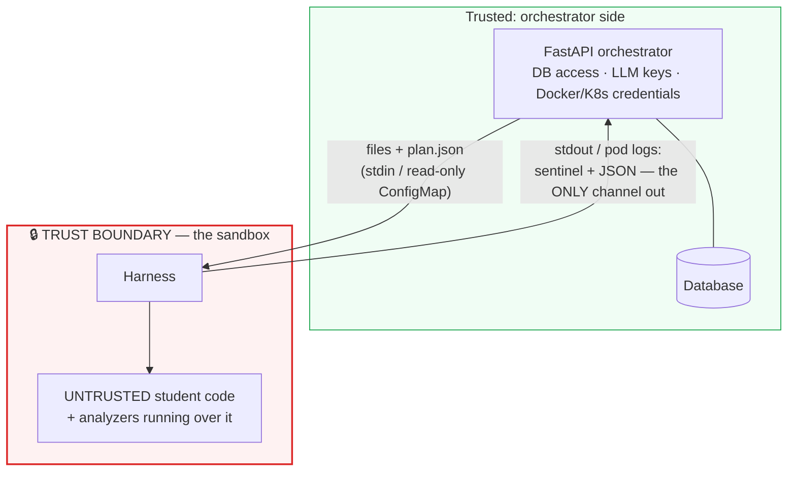

# Security model

This project executes **untrusted student code** on purpose. That makes the
sandbox the security-critical component, and this document its threat model:
what we protect, how, and — just as importantly — what risk remains. We would
rather document a real limitation than imply a guarantee the code doesn't
make.

The primary attacker is a **malicious student submission**: code crafted to
escape the sandbox, read other students' work, exhaust the host, forge its own
results, or reach the network. Students are authenticated but never trusted.

## Assets and trust boundaries

What the attacker might want:

- **The host machine / cluster node** — a sandbox escape is the worst case.
- **The orchestrator and its database** — every student's submissions,
  instructor and student token hashes, and the integrity of stored results.
- **Other students' submissions** — each sandbox must see exactly one.
- **Forged results** — making the orchestrator record findings/test results
  the sandbox never produced.
- **LLM API keys** — present only in the API process, never in the sandbox.
- **The network** — using the sandbox as an egress point (spam, scanning,
  crypto mining with exfiltration).



Everything that touches the submission — running it *and* statically analyzing
it — happens inside the boundary. The orchestrator only ever handles the
sandbox's captured text output; it never executes or imports student code.
Analyzer steps run *before* the student's program, on the pristine files, so
nothing the code does at runtime can alter what the analyzers saw.

The harness itself runs inside the boundary alongside the student code as the
same unprivileged user, so it is **not** a security control — it is treated as
compromisable, and nothing on the trusted side depends on its honesty beyond
the result-channel parsing rule described below.

## Controls

Exact flags from `backend/src/codeguide/execution/docker_backend.py`,
`backend/src/codeguide/execution/k8s_backend.py` and the Helm templates in
`deploy/helm/coding-learning-ai-guide/templates/`:

| Control | Compose (Docker backend) | Kubernetes backend | Kubernetes + gVisor |
|---|---|---|---|
| **Network isolation** | `network_disabled=True` — the container has no network interface at all | Default-deny `NetworkPolicy` in the sandbox namespace: **all ingress and all egress** blocked (requires a CNI that enforces NetworkPolicy) | same as Kubernetes |
| **Filesystem** | `read_only=True` rootfs; `/work` and `/tmp` are small size-capped tmpfs mounts, the only writable paths | `readOnlyRootFilesystem: true`; submission delivered via a **read-only** ConfigMap at `/work-src`; `/work` and `/tmp` are `emptyDir` volumes | same as Kubernetes |
| **User** | `user=65534:65534` (nobody), and the runner images themselves set `USER 65534` | `runAsNonRoot: true`, `runAsUser/runAsGroup: 65534` | same as Kubernetes |
| **Capabilities** | `cap_drop=["ALL"]` | `capabilities.drop: ["ALL"]` | same as Kubernetes |
| **Privilege escalation** | `security_opt=["no-new-privileges"]` | `allowPrivilegeEscalation: false` | same as Kubernetes |
| **Seccomp** | Docker's default seccomp profile (not overridden) | `seccompProfile: RuntimeDefault`, set explicitly | mostly moot — syscalls terminate in gVisor's user-space kernel |
| **Service account** | n/a | `automountServiceAccountToken: false` — no API credentials in the pod | same as Kubernetes |
| **Resource limits** | `mem_limit` + `memswap_limit` equal to it (no swap headroom), `nano_cpus`, `pids_limit`, size-capped `tmpfs` for `/work` (also `noexec,nosuid,nodev`) and `/tmp` (default 512 MiB / 1 CPU / 128 PIDs); wall-clock timeout (default 120 s) after which the container is killed | `resources.limits` for CPU, memory and `ephemeral-storage`; size-capped `emptyDir` scratch dirs; `activeDeadlineSeconds` (default 180) kills the Job; the orchestrator additionally stops waiting at the 120 s wall timeout. **No per-pod PID limit** — the Pod API has no such field; rely on the kubelet's `podPidsLimit` | same as Kubernetes |
| **Kernel isolation** | none — shares the host kernel | none — shares the node kernel | **gVisor (`runsc`)**: syscalls are handled by a user-space kernel; the sandbox opts in via `runtimeClassName` when `sandbox.gvisor.enabled=true` |

Layered on top of both backends, at the API instead of the sandbox:

- **Input validation before anything runs** — file-count and total-byte caps,
  a strict path allowlist (`^[\w\-./]+$`, no absolute paths, no `..`
  components, and `plan.json` is reserved so a submission cannot overwrite the
  harness's instructions), and a per-student rate limit (default 6
  submissions/minute).
- **Pinned tooling** — analyzer versions are pinned in the runner Dockerfiles,
  and semgrep runs entirely from vendored rule files with `--metrics=off`, so
  the sandbox never has a reason to want a network.

## The result channel

The sandbox has **no way to open a socket** — that is not a filtered
capability, it is the design. Results leave the sandbox exclusively through
container stdout (Docker) or pod logs (Kubernetes), as a JSON document printed
after a sentinel line:

```
===CODEGUIDE_RESULT_v1===
{ ... }
```

Why can't a submission forge its results?

1. **The verdict is never computed in the sandbox.** The harness reports only
   what the program *did* — its exit code and captured stdout/stderr. The
   pass/fail decision is made by the orchestrator (`grade_tests` in
   `backend/src/codeguide/queue.py`) by comparing the captured output against
   the expected value, which lives server-side. A submission that wants to
   "pass" has to actually produce the right output. (This also means hidden
   test cases' expected outputs are never shipped into the sandbox, so a
   program can't read them out of its own `plan.json`.)
2. **A submission can't reach the harness's stdout to inject a forged block.**
   The harness runs as PID 1, and — because a container shares one user — the
   student's code runs as the same UID. Without a countermeasure, a submission
   could double-fork a daemon that reopens the harness's own stdout via
   `/proc/1/fd/1` and append a second, forged `===CODEGUIDE_RESULT_v1===`
   block *after* the real one. The harness closes that hole by calling
   `prctl(PR_SET_DUMPABLE, 0)` before any student code runs, which makes
   `/proc/1/{fd,mem,environ}` owned by root and unreadable by the same UID.
   The `test_cannot_forge_result_via_proc_fd` integration test exercises
   exactly this attack and confirms the forged result is not trusted.
3. **The parser only trusts the *last* exact sentinel line**
   (`parse_harness_output`), and student output is captured into JSON string
   values (escaped, truncated at 256 KiB) where a printed sentinel is inert
   text — so the trivial "just print the sentinel" attack is a non-event.

The inbound direction is equally constrained: files arrive as a gzipped JSON
payload over stdin (Docker — chosen precisely so the read-only rootfs never
has to be relaxed) or via a read-only ConfigMap mount (Kubernetes), and the
harness refuses to materialize any path that resolves outside `/work`.

## Kubernetes specifics

The Helm chart treats the sandbox as a blast-radius exercise:

- **A dedicated namespace** (`clag-sandbox` by default) contains every
  per-submission Job and ConfigMap, and nothing else.
- **Default-deny NetworkPolicy** (`templates/sandbox-namespace.yaml`) with an
  empty pod selector and both `Ingress` and `Egress` policy types: sandbox
  pods can neither be reached nor reach out.
- **Scoped RBAC** (`templates/rbac.yaml`): the API's ServiceAccount is bound
  to a namespaced Role that permits exactly `jobs`
  (create/get/list/watch/delete), `configmaps` (create/get/delete), `pods`
  (get/list) and `pods/log` (get) — **in the sandbox namespace only**. A
  compromised API pod cannot touch other namespaces or any other resource
  kinds, and the sandbox pods themselves carry no ServiceAccount token at all.
- **Lifecycle bounds**: `backoffLimit: 0` (no retries of possibly-hostile
  code), `activeDeadlineSeconds` as the hard kill switch,
  `ttlSecondsAfterFinished: 300` as belt-and-braces reaping, plus explicit
  Job + ConfigMap deletion in the backend's cleanup path.
- **Optional gVisor**: with `sandbox.gvisor.enabled=true` the chart registers
  a RuntimeClass and every sandbox pod runs under `runsc`, adding a user-space
  kernel between student code and the node kernel.

## Residual risks

Being honest about what the controls above do *not* cover:

1. **Compose mode mounts the host Docker socket into the API container.**
   This is how the API launches sandbox containers without running a daemon of
   its own, and it is a significant trust concession: access to
   `/var/run/docker.sock` is equivalent to root on the host. The sandbox
   containers themselves never see the socket — the exposure is that a
   compromise of the *orchestrator* (a FastAPI application that deliberately
   never executes student code) would escalate to the host. This is an
   accepted trade-off for the one-command local demo, not a recommended
   posture for multi-tenant production. The Kubernetes backend exists
   precisely to avoid it: there the API holds only the narrowly-scoped RBAC
   role above, not a daemon socket.
2. **Without gVisor, the sandbox shares the host/node kernel.** Namespaces,
   seccomp, dropped capabilities and no-new-privileges dramatically shrink the
   attack surface, but a kernel vulnerability reachable through the remaining
   syscall surface could still escape the sandbox. gVisor mitigates this class
   of attack by interposing a user-space kernel — but note that the `make
   kind-demo` walkthrough runs **without** gVisor (kind nodes don't ship
   `runsc`), so the gVisor path is exercised in configuration only, not
   verified end-to-end in that demo. Treat gVisor (or an equivalent, e.g.
   Kata) as required hardening for hostile multi-tenant deployments.
3. **Resource exhaustion is bounded, not prevented.** A determined submission
   can still burn its entire quota — full CPU for the whole wall-clock window,
   the full memory limit — for every submission it is allowed to make. The
   scratch dirs are size-capped on both backends (Docker tmpfs `size=`;
   Kubernetes `emptyDir.sizeLimit` plus a container `ephemeral-storage` limit),
   so a submission can't fill the host/node disk. Enrolment (`/auth/join`) and
   submission are both rate-limited per client, and the small worker pool caps
   concurrency — but these limiters are in-memory per API process, so they
   reset on restart and are per-replica when the API is scaled out; a shared
   store (e.g. Redis) would be needed for a multi-replica deployment. On
   Kubernetes, the Pod API has no per-pod PID field, so fork-bomb protection
   relies on the kubelet's `podPidsLimit` (the Docker backend sets
   `pids_limit=128` directly); set `podPidsLimit` on hostile multi-tenant
   nodes.

Smaller notes in the same spirit: instructor-authored assignment data (test
cases, analyzer config) is trusted input by design — instructors are a
different trust tier than students, not adversaries in this model; and the
demo Compose/Helm files ship development database credentials that must be
changed for anything internet-facing.

## Reporting a vulnerability

Please report suspected vulnerabilities privately — see
[SECURITY.md](../SECURITY.md) for the process. Reports demonstrating a sandbox
escape, cross-student data access, or result forgery are especially valuable.
